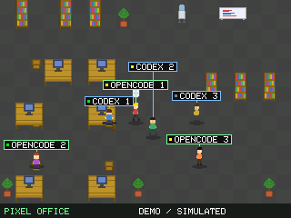

# ESP32 Agent Monitor

TFT-экран для Codex и OpenCode. Два режима:
- **Монитор** — реальные статусы сессий с Mac по Wi-Fi.
- **Пиксельный офис** — автономное демо с шестью персонажами, без подключения к агентам.



## 1. Что понадобится

- ESP32-S3 и SPI TFT **ST7789 240×320**.
- Провода и USB-кабель с передачей данных.
- [Arduino CLI](https://arduino.github.io/arduino-cli/installation/).
- Для монитора: Mac, Node.js 20+, Codex CLI и/или OpenCode **v2** с запущенным shared service.

## 2. Подключить экран

| TFT | ESP32-S3 |
|---|---|
| SCL / SCK | GPIO 42 |
| SDA / MOSI | GPIO 41 |
| CS | GPIO 47 |
| DC / A0 | GPIO 21 |
| RST / RES | GPIO 14 |
| GND | GND |
| VCC, BL / LED | Питание по документации своего модуля |

Экран используется горизонтально: `init(240,320)`, `setRotation(1)`.
[Подробнее о подключении и типичных проблемах](docs/HARDWARE.md).

## 3. Скачать код и установить библиотеки

```sh
git clone https://github.com/infinitybuddha29/esp32-agent-monitor.git
cd esp32-agent-monitor
arduino-cli config add board_manager.additional_urls https://espressif.github.io/arduino-esp32/package_esp32_index.json
arduino-cli core update-index
arduino-cli core install esp32:esp32@3.3.12
arduino-cli lib install "Adafruit GFX Library@1.13.0" "Adafruit ST7735 and ST7789 Library@1.12.0" "ArduinoJson@7.4.3"
arduino-cli board list
```

Последняя команда покажет порт платы. Дальше замените `<PORT>` на свой:
например, `/dev/cu.usbserial-110`, `/dev/ttyUSB0` или `COM3`.

## 4. Выбрать режим и прошить

### Пиксельный офис — самый быстрый запуск

```sh
arduino-cli compile --fqbn esp32:esp32:esp32s3:UploadSpeed=460800 firmware/PixelOfficeDemo
arduino-cli upload --fqbn esp32:esp32:esp32s3:UploadSpeed=460800 -p <PORT> firmware/PixelOfficeDemo
```

Подождите 8–12 секунд: персонажи начнут ходить и садиться за столы.
Wi-Fi и компьютер после прошивки не нужны, достаточно USB-питания.
[Настройка демо и снимок экрана](pixel-office-demo/README.md).

### Монитор реальных агентов

Mac и ESP32 должны быть в одной локальной Wi-Fi-сети.

**На Mac** запустите мост из корня репозитория и оставьте терминал открытым:

```sh
npm start
```

`npm install` не нужен. Мост использует встроенные модули Node.js.

**В другом терминале** подготовьте конфиг:

```sh
cp firmware/AgentMonitor/config.example.h firmware/AgentMonitor/config.h
scutil --get LocalHostName
```

В `firmware/AgentMonitor/config.h` впишите свой Wi-Fi и имя Mac из последней команды:

```cpp
#pragma once
#define WIFI_SSID "YOUR_WIFI_SSID"
#define WIFI_PASSWORD "YOUR_WIFI_PASSWORD"
#define BRIDGE_HOST "YOUR_MAC_HOSTNAME"  // без .local
#define BRIDGE_PORT 8787
```

Затем прошейте плату:

```sh
arduino-cli compile --fqbn esp32:esp32:esp32s3:UploadSpeed=460800 firmware/AgentMonitor
arduino-cli upload --fqbn esp32:esp32:esp32s3:UploadSpeed=460800 -p <PORT> firmware/AgentMonitor
```

На экране появятся названия чатов, статусы и длительность работы.
Мост должен оставаться запущенным. [Настройки моста](docs/BRIDGE.md).
Для переключения между режимами просто загрузите другой скетч — проводка одна.

## Использовано

Arduino/C++, Adafruit GFX + ST7789, ArduinoJson 7, Node.js.
Офис адаптирован из [underactive/pixel-agents-esp32](https://github.com/underactive/pixel-agents-esp32).
Монитор — MIT; офис — PolyForm Noncommercial. [Авторство и лицензии](THIRD_PARTY.md).

[Korolev Dev в Telegram](https://t.me/korolevdeveloper)
